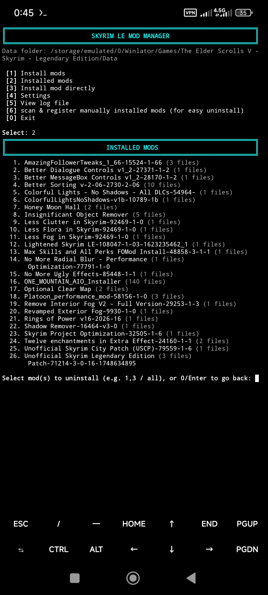
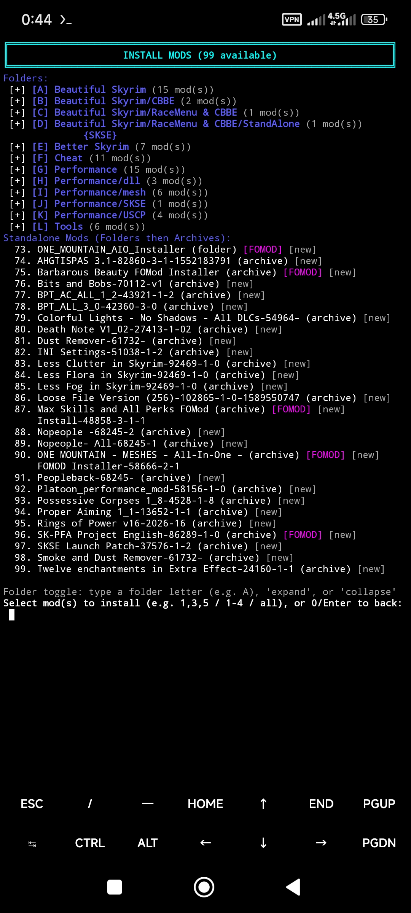

# Skyrim LE Mod Manager (SMM) - Termux Edition

SMM is a lightweight command-line mod manager for Skyrim LE with FOMOD support, file verification, and manual mod detection.

<p align="center">
  
  
</p>
   
> **Note:** This project was vibe-coded using free AI tools, so don't expect expect much but it gets the job done! If you find it useful for managing your mods give it a star i want see how it feels like (its my first time making something this useful)

### What It Does
* **FOMOD & Auto-Detect Installs:** Parses `ModuleConfig.xml` and `info.xml` for interactive FOMOD wizards, or automatically maps standard mod folders (`meshes`, `textures`, `.esp`, `.bsa`, etc.).
* **SHA-256 Verification & Safe Rollbacks:** Tracks every installed file in an SQLite database, verifies checksums after installation, and automatically rolls back changes if an install fails or gets canceled.
* **Detect Manually Installed Mods:** Scans your `Data` folder against your mod archives to adopt existing manual mods, find leftover/missing files, or clean up orphaned files.
* **Archive Support:** Extracts `.zip`, `.7z`, and `.rar` archives directly from your phone's storage.

### Quick Start
1. Install dependencies in Termux:
   ```bash
   pkg install python p7zip unrar unzip
   ```
2. Run the script:
   ```bash
   python3 skyrim_mod_manager.py
   ```
# IT WILL BE RELEASE SOON
